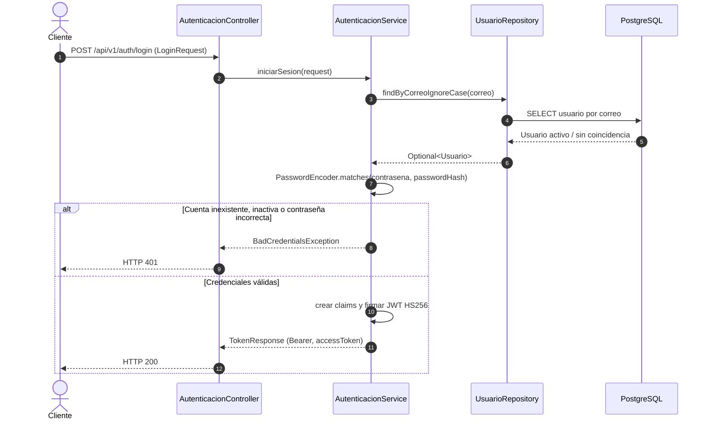
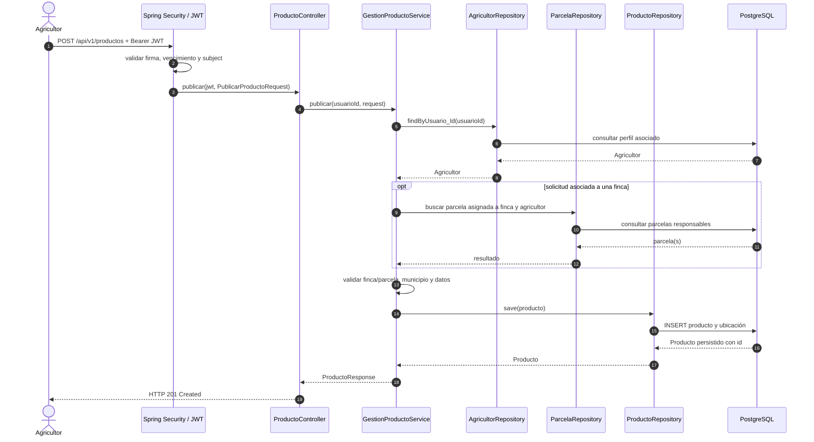
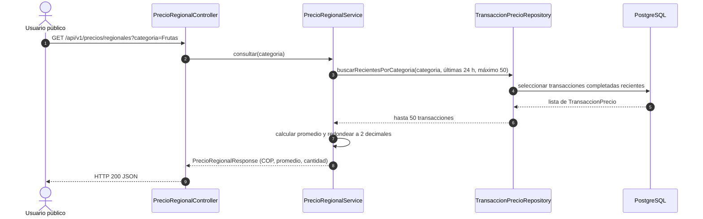
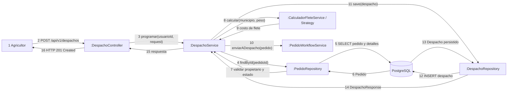
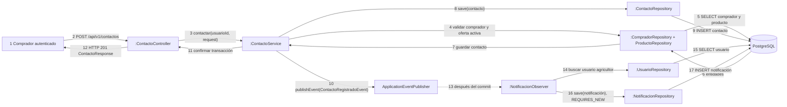
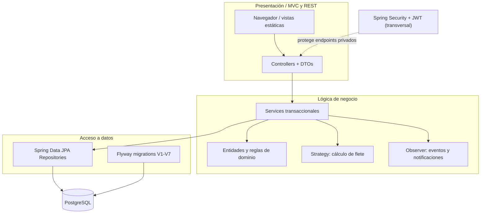
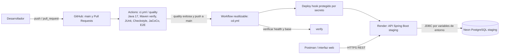

# Diagramas UML de AgroValle Connect

Este documento consolida diagramas Mermaid alineados con las rutas, clases y servicios que existen en `main`. Las figuras del laboratorio sirven como guía de tipos de diagrama; cuando un ID de HU o endpoint del ejemplo no coincide con el [Product Backlog](../requirements/product-backlog-bdd.md) y el código, aquí se usa la definición vigente del repositorio.

El código Java conserva el paquete `co.edu.uniajc.agrovalle`. La estructura `com.agrovalle.connect` del ejemplo del laboratorio no se copia porque cambiar el paquete completo no es una tarea de organización documental.

## 1. Secuencia: inicio de sesión con JWT

## 2. Secuencia: publicar cosecha (HU-02)

## 3. Secuencia: consulta de precios regionales (HU-03)

## 4. Comunicación: programación de despacho (HU-12 según el Backlog vigente)

Mermaid no ofrece un tipo nativo de diagrama de comunicación UML; este flujo usa participantes y mensajes numerados para mostrar la colaboración.

## 5. Comunicación: notificación observada después de registrar contacto (HU-11)

El laboratorio asocia este ejemplo a HU-13, pero el [Product Backlog](../requirements/product-backlog-bdd.md) define las notificaciones de contacto en HU-11. La trazabilidad de pedidos se mantiene en HU-13.

## 6. Componentes: arquitectura de cuatro capas

## 7. Despliegue: CI y staging actuales

El workflow `ci.yml` ejecuta la calidad en cada push y Pull Request. Solo un push exitoso a `main` llama al workflow reutilizable `cd.yml`, que solicita el despliegue y después verifica readiness y base de datos; así se conservan las comprobaciones y no se crean dos disparadores de despliegue. La ruta de salud implementada es `/api/v1/health`. La aplicación lee la configuración desde `application.properties` y variables de entorno; no necesita un `application-staging.yml` para este despliegue.

## Fuentes editables y alcance

- Los diagramas PlantUML fuente, DER, esquema y mockups permanecen en [`../diseno/README.md`](../diseno/README.md).
- La versión UML anterior se conserva en [`diagramas-uml-historico.md`](diagramas-uml-historico.md) como referencia, no como fuente vigente.
- El repositorio implementa pedidos, reservas y despachos; los nombres de HU se toman del [Product Backlog](../requirements/product-backlog-bdd.md), no de IDs ilustrativos del laboratorio.
