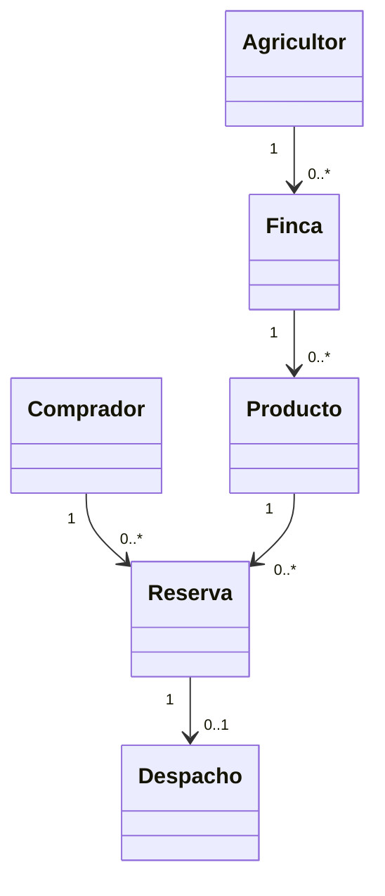

# Modelo inicial (antecedente histórico)

Este diagrama representa el modelo conceptual inicial del proyecto. Se conserva como antecedente de diseño; sus relaciones no describen por sí solas el esquema vigente ni sustituyen las migraciones.

La implementación actual evolucionó desde esta propuesta. El esquema ejecutable lo definen las migraciones Flyway V1–V7 en `src/main/resources/db/migration/`; el DER actualizado, sus diferencias y el snapshot DDL se consultan en la [reconciliación del DER](reconciliacion-der.md), las [decisiones de normalización](decisiones-normalizacion.md) y [`schema.sql`](schema.sql). El backend ya utiliza PostgreSQL para integración y staging, y H2 en pruebas locales.
