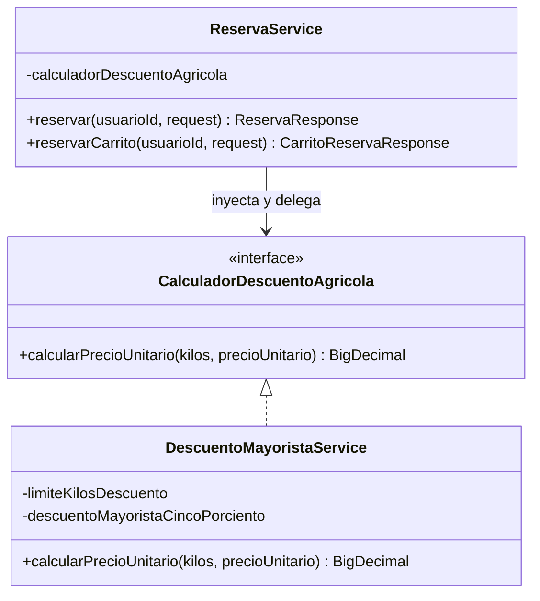
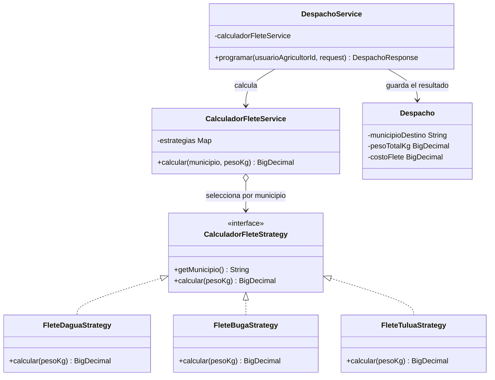
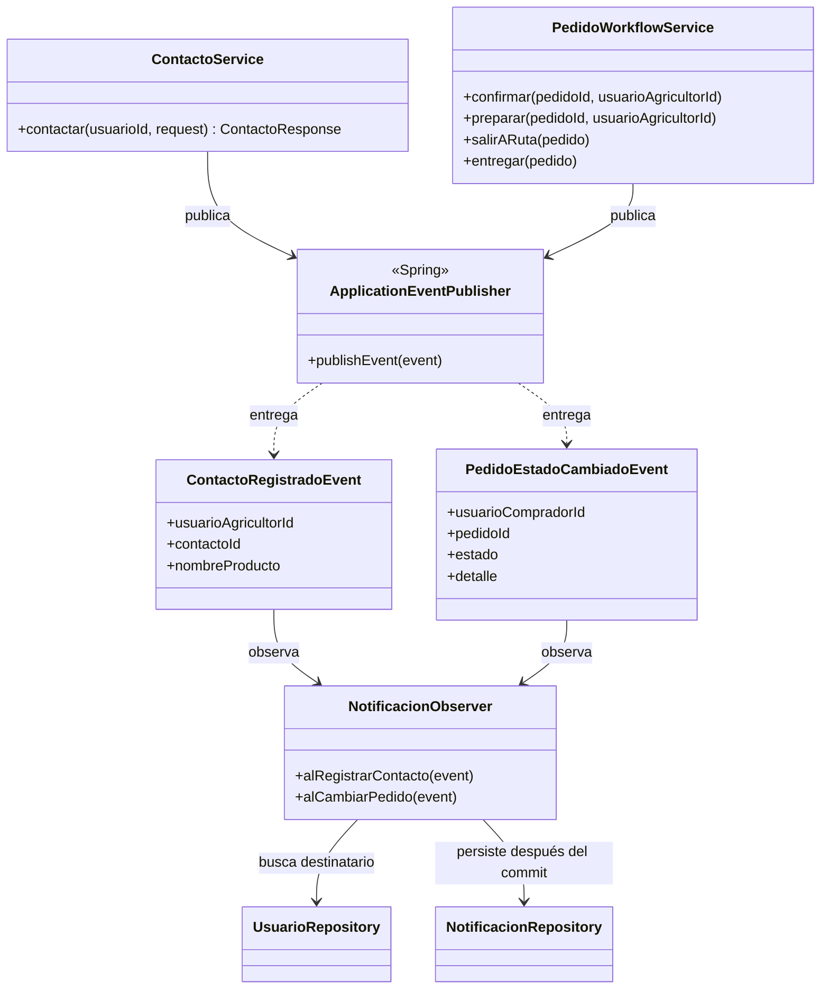

# Patrones GoF aplicados en AgroValle Connect

## Alcance

La Sesión 9 solicita implementar al menos un patrón de comportamiento y documentar el problema que resuelve junto con su diagrama de clases. El código actual ya aplica **Strategy** al calcular el precio por kilogramo en una reserva y **Observer** para emitir notificaciones después de publicar eventos de contacto o cambios de pedido. Esta documentación describe esos flujos existentes; no registra una actividad de Sprint 2 ni un acuerdo del equipo.

## Strategy: cálculo del descuento mayorista

### Problema de negocio

Las reservas individuales y las reservas desde el carrito deben aplicar la misma regla de precio por kilogramo cuando la cantidad reservada supera los 100 kg. Mantener esa regla dentro de cada flujo duplicaría lógica y acoplaría `ReservaService` a la fórmula del descuento.

### Aplicación

- `CalculadorDescuentoAgricola` define la estrategia de cálculo del precio unitario.
- `DescuentoMayoristaService` implementa el algoritmo actual: aplica 5 % de descuento si la cantidad supera 100 kg; en 100 kg o menos conserva el precio.
- `ReservaService` recibe la interfaz por inyección de constructor y la usa tanto en `reservar` como en `reservarCarrito`.
- `DescuentoMayoristaServiceTest` cubre el límite de 100 kg y el caso que supera ese límite. `AgrovalleConnectApplicationTests` verifica además el precio de una reserva a través del endpoint.

La interfaz permite sustituir o añadir estrategias sin cambiar el contrato HTTP. En el estado actual solo hay una implementación Spring registrada; si se agregan varias, deberá definirse una selección de estrategia explícita antes de conectarlas al contexto para evitar una inyección ambigua.

## Strategy: cálculo de flete por municipio

### Problema de negocio

El costo de traslado depende del destino y del peso total del pedido. Un condicional por municipio dentro de `DespachoService` haría que cada ruta nueva obligara a cambiar el flujo de programación del despacho.

### Aplicación

- `CalculadorFleteStrategy` define una estrategia de cálculo por destino.
- `FleteDaguaStrategy`, `FleteBugaStrategy` y `FleteTuluaStrategy` implementan las tarifas demostrativas de la guía, registradas como componentes Spring.
- `CalculadorFleteService` construye un mapa de estrategias y selecciona por municipio sin condicionales por ruta.
- Al programar un despacho, se recibe `municipio_destino`, se suman los kilogramos de las líneas del pedido, y se persisten municipio, peso y costo calculado. La respuesta incluye esos tres datos.
- Para municipios sin tarifa configurada la API responde 400; no se estima ni se cobra una tarifa silenciosa.

| Municipio destino | Tarifa académica de ejemplo | Regla |
| --- | ---: | --- |
| Dagua | $1.200 COP/kg + $5.000 COP base | peso × 1.200 + 5.000 |
| Buga | $800 COP/kg | peso × 800 |
| Tuluá | $950 COP/kg | peso × 950 |

Estos valores se usan para el ejercicio de patrones y no representan tarifas comerciales validadas. Los despachos históricos conservan los campos nuevos nulos porque el repositorio no registra el peso ni el municipio de entrega de esos envíos.

## Observer: notificaciones transaccionales

### Problema de negocio

Al crear un contacto sobre una oferta o cambiar el estado de un pedido, la persona interesada debe recibir una notificación persistida. El servicio que ejecuta la operación no necesita conocer cómo se construye ni se guarda esa notificación.

### Aplicación

- `ContactoService` publica `ContactoRegistradoEvent` cuando registra el contacto.
- `PedidoWorkflowService` publica `PedidoEstadoCambiadoEvent` al guardar cada transición válida del pedido.
- `NotificacionObserver` escucha ambos eventos con `@TransactionalEventListener(AFTER_COMMIT)` y guarda la notificación en una transacción nueva.
- Si la operación principal falla y hace rollback, el listener no procesa el evento. El procesamiento es síncrono después del commit; el código no configura `@Async`.
- Las pruebas de `NotificacionObserverTest` verifican por separado cada evento y que no se persista una notificación cuando el usuario destinatario no existe. Los escenarios de integración REST comprueban el registro de contacto y su notificación.

## Verificación de calidad

El proyecto aplica Checkstyle durante `verify` y en el hook local `pre-commit`. JaCoCo exige al menos 60 % de cobertura de instrucciones, ramas y líneas para el bundle. `CalculadorFleteServiceTest` cubre las estrategias de los tres municipios, la normalización del nombre y el rechazo de peso o municipio no válido. El resultado de `clean verify` y el estado de CI se registran para el commit evaluado.

## Alcance de las tarifas

Las tarifas anteriores son datos de demostración indicados para la entrega académica. No deben interpretarse como precios comerciales vigentes; una operación real debe reemplazarlas por tarifas acordadas y mantenibles desde configuración o datos de negocio.
