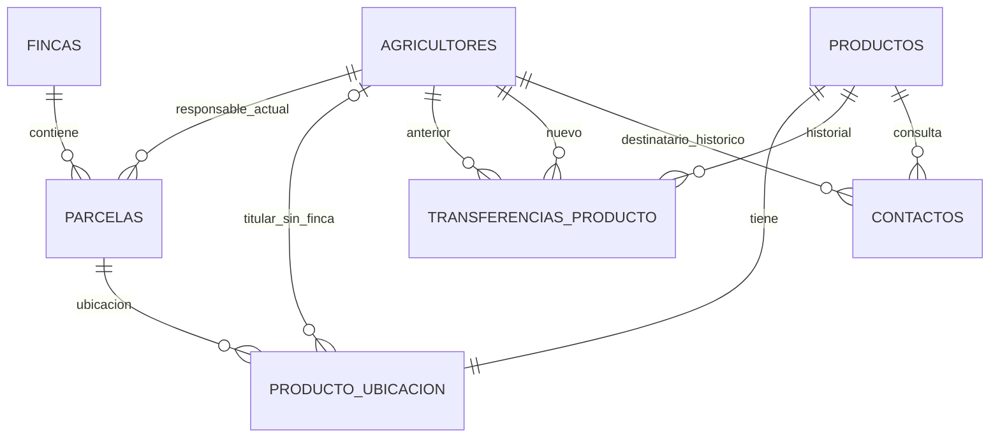

# Modelo 3FN: fincas, parcelas y productos

**Estado:** implementado en Flyway V7 y en las entidades, servicios y API, e integrado en `main`. Actions #103 ejecutó las pruebas y controles de calidad sobre el commit `a7e2097`.

## Reglas implementadas

1. Cada parcela tiene un registro propio, pertenece a una finca y apunta a su responsable agricultor actual. El alta de una finca crea una parcela `GENERAL` para representar el área completa.
2. Todo producto asociado a finca referencia una parcela. Un producto sin finca conserva su municipio y agricultor independiente.
3. El municipio de un producto con parcela se deriva desde la finca de esa parcela.
4. Transferir una parcela cambia su responsable actual y registra una fila por cada producto de esa parcela, con agricultor anterior, nuevo agricultor y fecha. Transferir un producto sin finca afecta solo ese producto.
5. El contacto conserva el agricultor asociado en el momento de creación; las transferencias posteriores no lo reescriben.

## Relaciones

### Tablas principales

- `fincas(id, agricultor_id, nombre, municipio, direccion, ...)`
- `parcelas(id, finca_id, codigo, agricultor_responsable_actual_id, creada_en)`; `UNIQUE(finca_id, codigo)`.
- `productos(id, nombre, categoria, cantidad_kg, precio_por_kg, fecha_cosecha, estado, ...)`; ya no tiene `finca_id`, `agricultor_id` ni `municipio`.
- `producto_ubicacion(id, producto_id, parcela_id, agricultor_sin_finca_id, municipio_sin_finca)`; una fila única por producto, con parcela o municipio independiente.
- `transferencias_producto(id, producto_id, agricultor_anterior_id, agricultor_nuevo_id, fecha_transferencia)`.
- `contactos.agricultor_id` sigue siendo la referencia histórica al destinatario.

## Dependencias funcionales y 3FN

- `fincas.id → agricultor_id, nombre, municipio, direccion`. El municipio pertenece a la finca.
- `parcelas.id → finca_id, codigo, agricultor_responsable_actual_id`. El municipio se consulta por finca y no se copia a parcela ni producto.
- `productos.id → nombre, categoria, cantidad_kg, precio_por_kg, fecha_cosecha, estado, ...`. La tabla conserva atributos propios del producto.
- `producto_ubicacion.producto_id → parcela_id` para producto de finca, o `agricultor_sin_finca_id, municipio_sin_finca` para producto independiente. Municipio y titularidad de una parcela se derivan por relaciones, sin repetirse en `productos`.
- `transferencias_producto.id → producto_id, agricultor_anterior_id, agricultor_nuevo_id, fecha_transferencia`. Cada registro describe un hecho fechado; no se recalcula desde el responsable vigente.
- `contactos.id → comprador_id, agricultor_id, producto_id, mensaje, estado, creado_en`. `agricultor_id` pertenece al hecho de contacto y se conserva como snapshot.

Esto elimina la duplicación `producto → finca → municipio` y evita mantener un agricultor de producto duplicado frente al responsable actual de la parcela. Categoría continúa siendo texto; sus valores repetidos no demuestran por sí solos una violación de 3FN. El issue #46 mantiene los catálogos de municipios y categorías como mejora futura.

## Migración de los registros existentes

V7 crea una parcela `MIGRACION-{agricultorId}` por cada combinación previa de finca y agricultor ligado a sus productos. Si el producto no tenía agricultor, se usa el agricultor registrante de la finca. Las fincas sin producto reciben `GENERAL`. Los productos sin finca trasladan su agricultor y municipio a `producto_ubicacion`. Los contactos existentes se conservan y mantienen el agricultor destinatario. Luego se eliminan de `productos` las columnas redundantes `finca_id`, `agricultor_id` y `municipio`.

## API añadida/actualizada

- `GET /api/v1/parcelas/mias`
- `POST /api/v1/fincas/{fincaId}/parcelas` con `{ "codigo": "Parcela norte" }`
- `POST /api/v1/productos` recibe `parcelaId`; sin parcela exige `municipio`. El campo antiguo `fincaId` se mantiene temporalmente si corresponde a una sola parcela del agricultor.
- `POST /api/v1/productos/{id}/transferencias` con `{ "nuevoAgricultorId": 2 }`
- `GET /api/v1/productos/{id}/transferencias`

La lista pública de productos conserva sus campos de respuesta; el municipio y agricultor se resuelven desde la nueva ubicación.
